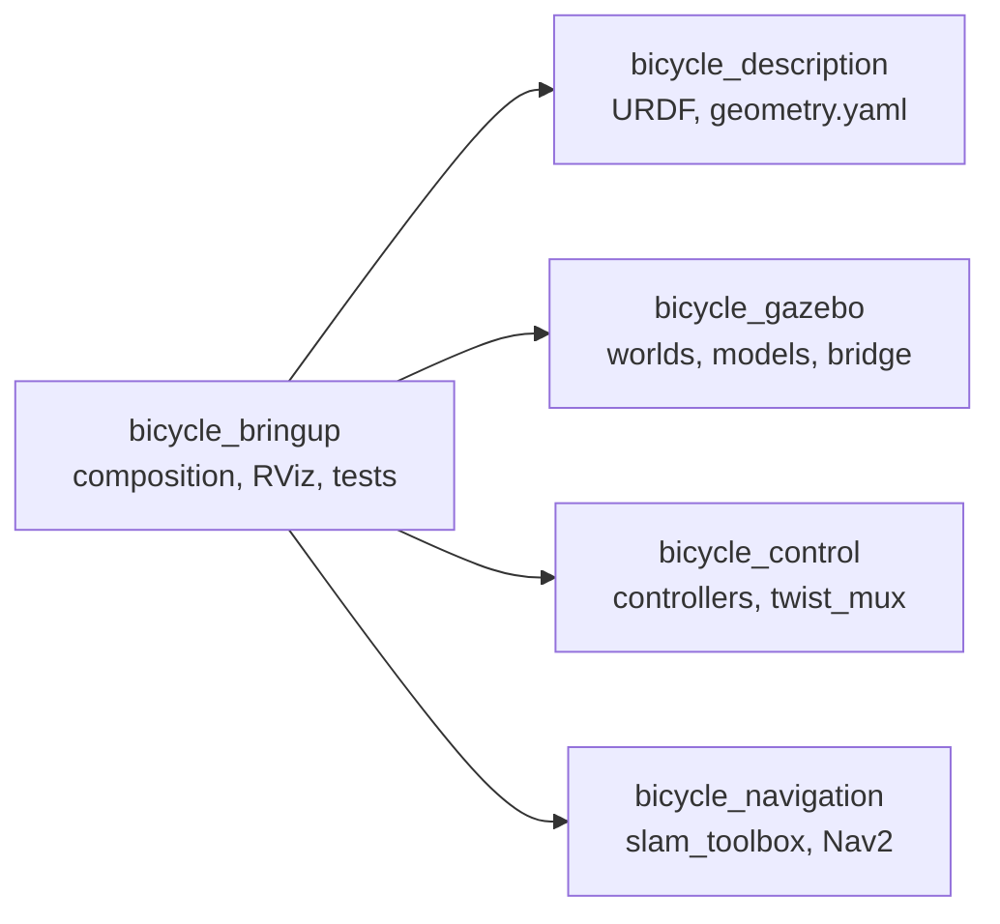
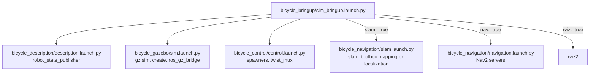
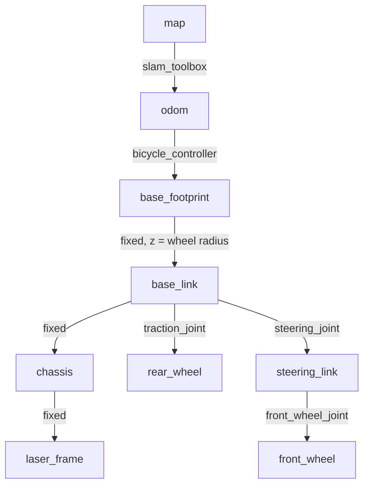
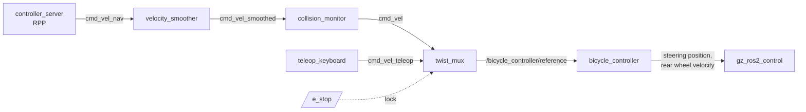

# Architecture

## Packages

Each package owns one concern and depends only on what it uses. Dependencies point one way:

- `bicycle_description` knows nothing about Gazebo or Nav2. The ros2_control hardware
  plugin is a xacro argument (`hardware_plugin`), so the hardware package can reuse the
  description with its own system plugin.
- `bicycle_control` knows nothing about Gazebo: the controller_manager is provided by the
  hardware layer (gz_ros2_control in simulation, ros2_control_node on the robot).
- `bicycle_navigation` only relies on the topic and frame contract below.
- `bicycle_bringup` only composes; it also holds the tests that span packages.

## Launch composition

Every component launch file also runs on its own. Arguments given on the command line reach
the included files (`--show-args` lists them all).

Start-up sequence in simulation:

1. robot_state_publisher publishes `/robot_description` (with `use_sim:=true`).
2. Gazebo starts the world; `create` spawns the model from `/robot_description`.
3. gz_ros2_control starts a controller_manager inside Gazebo and reads the robot description
   and `bicycle_control/config/bicycle_controller.yaml`.
4. The spawners activate `joint_state_broadcaster` and `bicycle_controller`.
5. slam_toolbox (a lifecycle node, auto-activated) starts publishing `map -> odom`.
6. Nav2's lifecycle manager configures and activates the servers once TF is available.

## TF tree

`base_footprint` is the ground point under the **rear axle**: the reference point of the
bicycle kinematic model, of the controller's odometry and of Nav2's footprint and planner.
`base_link` is the rear axle centre. Frames follow REP-103/REP-105 (x forward, z up).

## Topic and frame contract

| Name | Type | Producer → consumer |
|---|---|---|
| `/clock` | `rosgraph_msgs/Clock` | ros_gz_bridge → every node (sim time) |
| `/robot_description` | `std_msgs/String` | robot_state_publisher → Gazebo spawn, controller_manager, RViz |
| `/scan` (frame `laser_frame`) | `sensor_msgs/LaserScan` | ros_gz_bridge → slam_toolbox, costmaps, collision_monitor |
| `/joint_states` | `sensor_msgs/JointState` | joint_state_broadcaster → robot_state_publisher |
| `/odom`, TF `odom → base_footprint` | `nav_msgs/Odometry` | bicycle_controller → Nav2 |
| `/map`, TF `map → odom` | `nav_msgs/OccupancyGrid` | slam_toolbox → Nav2, RViz |
| `/cmd_vel` | `geometry_msgs/TwistStamped` | Nav2 collision_monitor → twist_mux (priority 10) |
| `/cmd_vel_teleop` | `geometry_msgs/TwistStamped` | teleop → twist_mux (priority 100) |
| `/e_stop` | `std_msgs/Bool` | operator → twist_mux lock (priority 255, latched) |
| `/bicycle_controller/reference` | `geometry_msgs/TwistStamped` | **only** twist_mux → bicycle_controller |

`bicycle_bringup/test/test_consistency.py` checks the frame names and the `/scan` topic in
every configuration file.

## Velocity command pipeline

- All messages are `TwistStamped` (the Jazzy controllers no longer accept `Twist`).
- The controller stops when no command arrives for `reference_timeout` (0.5 s). Command
  stamps must use the same clock as the controller (sim time in simulation), which is why
  the teleop wrapper sets `use_sim_time`.
- The e-stop lock mutes every source until `false` is published.

## Simulation model notes

- The bicycle has no balance controller: its 0.20 m wide wheels keep it statically upright.
  A physics check under Gazebo Harmonic (DART) showed it stays upright at rest and while
  driving circles at 0.5 m/s with 0.5 rad of steering. The integration test checks that it
  is still upright after driving.
- The wide wheels scrub when steering, so the real turning radius is slightly larger than
  the kinematic one. Wheel odometry drifts in turns as a result; SLAM corrects it.
- The lidar sits on a mast at the chassis centre, 0.65 m above the ground, so the scan plane
  clears the wheels (0.50 m tall) and does not see the robot itself.
